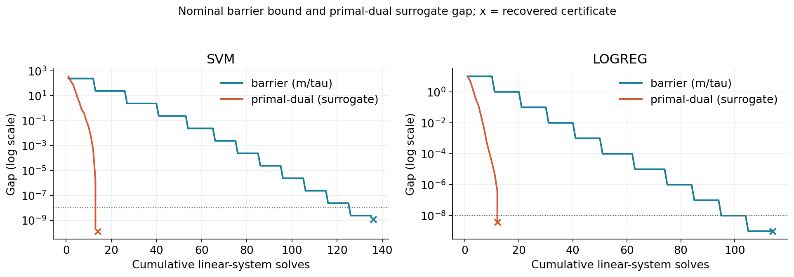
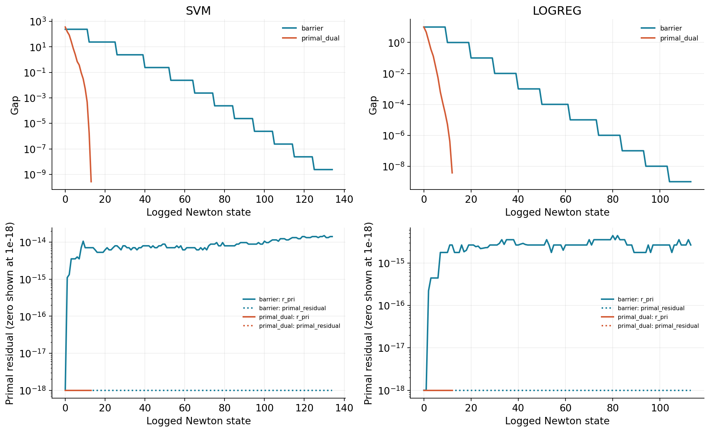
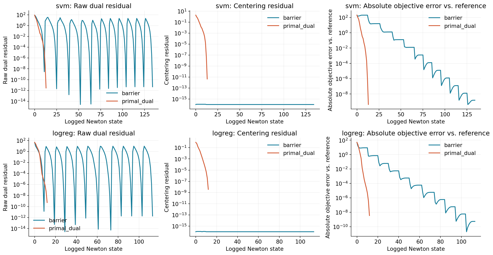
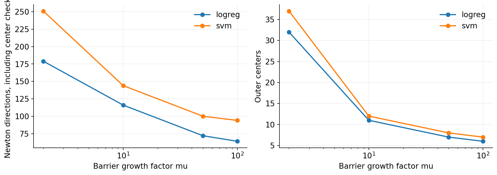
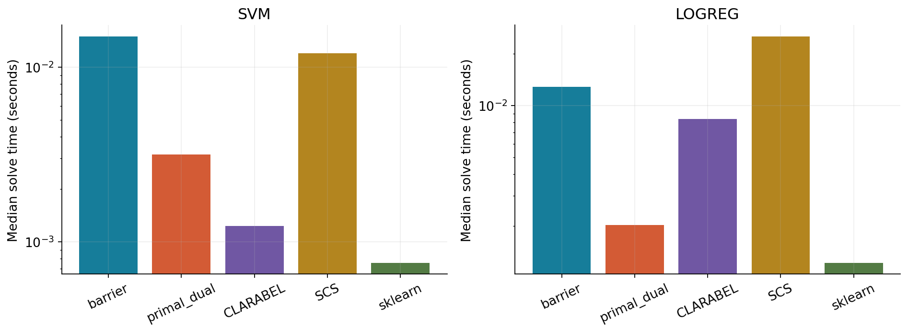
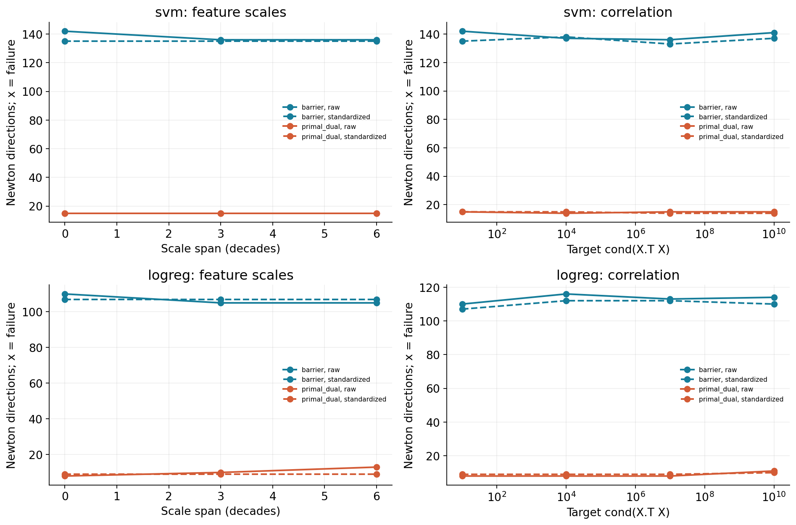
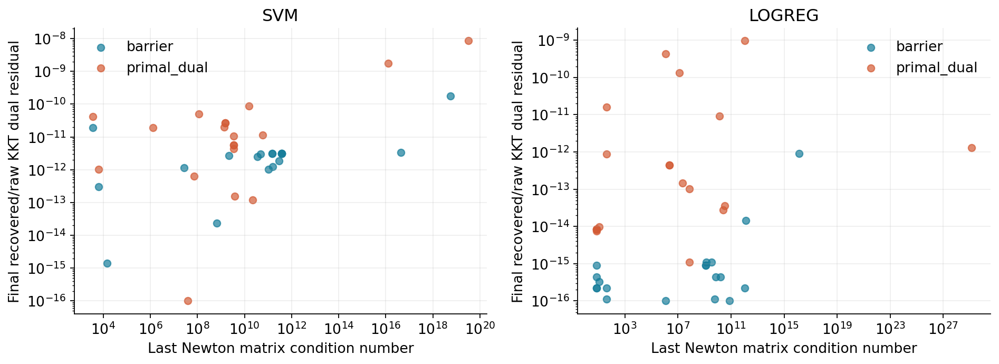
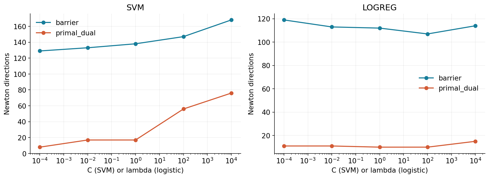
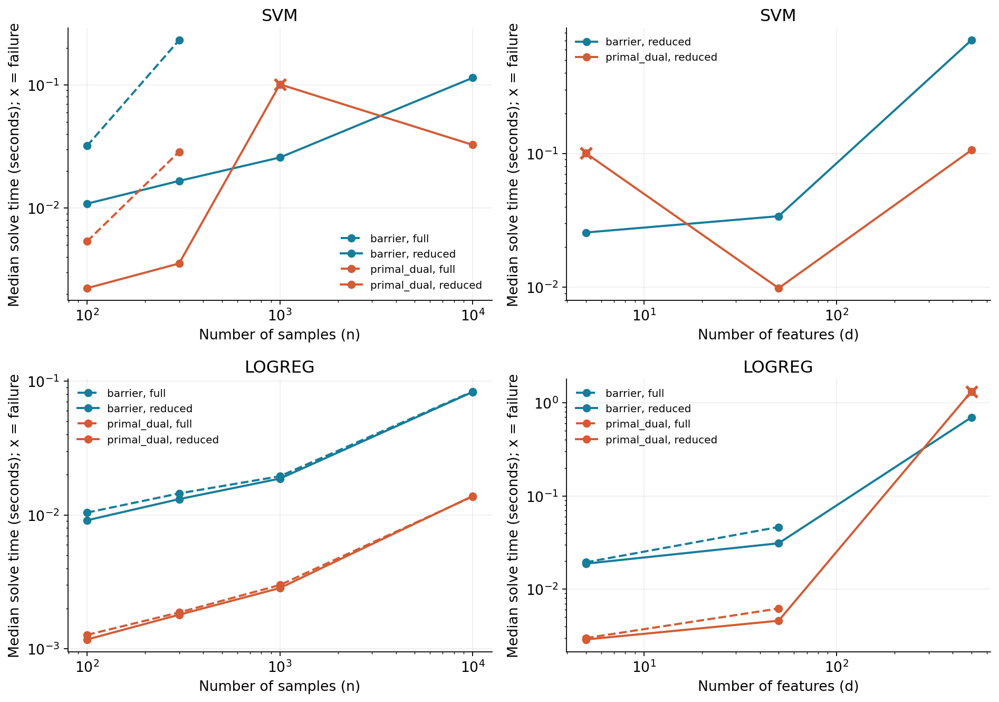
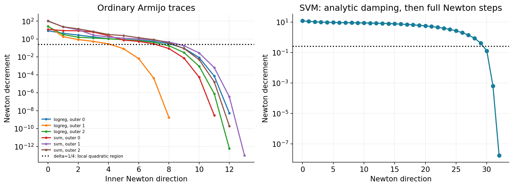

# Why do interior-point methods need so few iterations?

A reproducible comparison on soft-margin SVM and L1 logistic regression

## Introduction and central question

Iteration counts alone conceal the cost of an optimization algorithm. We compare
a log-barrier method and a primal-dual Newton method written from scratch, then
measure objective accuracy, residuals, linear-system work, and elapsed time.
The main question is whether the small number of Newton steps offsets their
matrix cost, and how conditioning changes that answer.

The correctness study contains 30 solver runs. Across its 12
custom runs, the largest relative objective error against high-accuracy CLARABEL
is 2.33e-10. The smallest prediction agreement
with sklearn is 100.0%. These are checks on the
listed datasets, not a claim of universal robustness. The size study records
3 unsuccessful rows, including repeated configurations in two
slices; these are retained below with the unmet stopping criteria.

## Theory

With f(z)=Gz+h<=0 and m inequalities, use phi=-sum log(-f_i). At the exact
minimizer of F_tau=tau f0+phi, stationarity gives lambda_i=-1/(tau f_i).
Convexity makes this point minimize its Lagrangian; substituting shows the
primal-dual objective gap is exactly m/tau. This justifies a barrier outer loop
that multiplies tau by mu. At an approximate center, m/tau is a nominal bound:
stationarity, the stored slack identity, and a genuine dual certificate are
checked separately. Equations (3)-(8) in the appendix give the derivation.

The Newton direction solves H dz=-g. The squared decrement is -tau g'dz when
using the numerically scaled objective f0+phi/tau. Backtracking preserves
positive slacks and accepts a sufficient decrease. The SVM objective plus its
log barrier is standard self-concordant: the third directional derivative is
bounded by twice the 3/2 power of the second. Analytic damping has a guaranteed
objective decrease; once the decrement is small, full steps converge
quadratically. The short-step path bound is O(sqrt(m) log(m/epsilon)), with
initialization and centering assumptions. Our aggressive fixed mu values and
Armijo line search are measured separately from that theorem. Equations
(9)-(11) give both the short-step argument and a conservative fixed-mu bound.

Logistic loss satisfies a different inequality: its third derivative is bounded
by its second derivative times a design-direction norm. This generalized
self-concordance does not imply the standard SVM Newton-step bound. We make no
standard self-concordance guarantee for the logistic barrier objective.

The primal-dual method applies Newton to stationarity, affine feasibility,
and s_i lambda_i=kappa. Eliminating slack and multiplier directions leaves
H0+G' diag(lambda/s) G. There is one direction per iteration and no inner
centering loop. Near a sufficiently stationary solution the centering target
is proportional to (eta/m)^(3/2), and the boundary fraction approaches one.
This permits a faster local phase without an extra predictor solve. The
stationarity guard prevents prematurely collapsing complementarity under huge
regularization. Equations (13)-(16), (28) derive the method and its limitations.

## Problem formulations

SVM uses z=(w,b,xi), objective 0.5||w||^2+C sum xi, and constraints
1-diag(y)[X,1](w,b)-xi<=0 and -xi<=0. There are exactly 2n inequalities.
Logistic regression uses z=(w,b,v), objective sum log(1+exp(-y(Xw+b)))
+lambda sum v and constraints w-v<=0 and -w-v<=0, exactly 2d inequalities.
Every custom and CVXPY solve uses these variables and inequalities.
The intercept is unpenalized. No dual SVM or kernel implementation is used.

The synthetic data have Gaussian noise, controlled overlap, and a fixed seed
1729. Separable examples force a strict signed margin along one feature.
The real-data study uses the packaged Breast Cancer Wisconsin Diagnostic data,
a stratified 75/25 train/test split, and training-only standardization.
Its source and description are in the [sklearn dataset documentation](https://scikit-learn.org/stable/modules/generated/sklearn.datasets.load_breast_cancer.html).
All optimization comparisons use the same training rows; test accuracy is
reported as a descriptive statistic, without hyperparameter selection.

## Implementation

Only NumPy/SciPy linear algebra is called by the custom methods. A single
ledger counts every attempted solve, including failed direct attempts,
least-squares fallbacks, and certificate recovery. There is no optimizer
library inside the algorithms. Feature and identity Jacobian products are
computed without materializing full constraint matrices on the reduced path.

For SVM, eliminating xi turns the (n+d+1)-square Newton matrix into
Q+A' diag(ab/(a+b)) A of size d+1. Its formation costs O(nd^2) and its dense
factorization O(d^3), with O(nd+d^2) storage. Full dense factorization grows
as O((n+d)^3). Logistic epigraph variables can also be eliminated, adding
4ab/(a+b) to the w diagonal. Equations (18)-(20) derive both reductions.
Diagonal equilibration changes coordinates without adding regularization.

The barrier method retains small affine slacks by s_new=s-alpha G dz. It
reports the discrepancy f(z)+s and direct primal violations. Raw central
multipliers and recovered certificates remain distinct. An SVM certificate
uses box constraints and intercept balance, with a counted active-margin
least-squares candidate only if stationarity improves. The logistic dual
certificate balances sigmoid probabilities and shrinks them into the L-infinity
constraint. Equations (21)-(23), (27) explain these checks.

Timings are medians of repeated runs with one BLAS thread. The main timing
study warms each method once. Problem data construction, method setup, solve,
and condition-number diagnostics are separate fields. Custom solve time
includes certification. CVXPY setup includes canonicalization. Native solver
setup can still be part of its wall-clock solve call. Baseline internal solve
counts are unavailable and left blank. Hardware-dependent times are not
bitwise reproducible; data and algorithmic settings are fixed.

## Verification

The test suite checks objective and barrier gradients and Hessians by central
finite differences, affine Jacobian products, and the full perturbed-KKT
Jacobian against the eliminated direction. Full and reduced directions agree
to 2e-10. It checks box-dual feasibility, true dual lower bounds, final KKT
residuals below 1e-6, exact computation of m/tau, gaps below 1e-8, prediction
agreement of at least 99%, and exact agreement on separable cases.

Edge cases include duplicate and conflicting points, a constant feature,
separable and overlapping data, regularization 1e-4 and 1e4, and logistic tails
of magnitude 1e6. A coordinate transformation test checks Newton invariance
without changing the statistical model. Integration tests execute all seven
experiments at small sizes and check their numeric and artifact contracts.
Full-size stress failures are logged, not converted to passing solver returns.

| Dataset | Problem | Method | Rel. obj. error | Agreement | Final gap |
| --- | --- | --- | --- | --- | --- |
| synthetic | svm | barrier | 6.9e-11 | 1 | 2e-09 |
| synthetic | svm | primal_dual | 2.86e-12 | 1 | 5.58e-11 |
| synthetic | logreg | barrier | 4.22e-11 | 1 | 1e-09 |
| synthetic | logreg | primal_dual | 9.03e-12 | 1 | 2.31e-10 |
| separable | svm | barrier | 2.33e-10 | 1 | 2e-09 |
| separable | svm | primal_dual | 1.47e-11 | 1 | 1.02e-10 |
| separable | logreg | barrier | 1.04e-10 | 1 | 1e-09 |
| separable | logreg | primal_dual | 9.74e-13 | 1 | 2.4e-11 |
| breast_cancer | svm | barrier | 1.23e-11 | 1 | 8.54e-10 |
| breast_cancer | svm | primal_dual | 7.46e-12 | 1 | 3.71e-09 |
| breast_cancer | logreg | barrier | 6.53e-12 | 1 | 6e-10 |
| breast_cancer | logreg | primal_dual | 3.5e-12 | 1 | 1.22e-09 |

## Computational comparison

The primary figure puts nominal barrier bounds and primal-dual surrogate gaps
against cumulative actual linear-system solves. The two quantities agree with
true primal-dual gaps only under their stated stationarity assumptions.
Cross markers show recovered certificate gaps after recovery work. CLARABEL
and SCS do not expose comparable per-system solve histories, so their lines
are not invented. Their endpoints and times appear in the comparison table.

The convergence examples show a local acceleration in the primal-dual method:

| Problem | Method | Newton dirs. | Solves | Last gap ratio |
| --- | --- | --- | --- | --- |
| svm | barrier | 135 | 136 | 1 |
| svm | primal_dual | 13 | 14 | 0.000157 |
| logreg | barrier | 114 | 114 | 1 |
| logreg | primal_dual | 12 | 12 | 0.00914 |

A barrier outer bound stays constant during centering and drops when tau
changes. Therefore its within-center bound trace cannot diagnose Newton's
local rate; the decrement and objective traces serve that purpose. The
primal-dual method changes both point and target each iteration. A fixed
centering fraction would impose a linear contraction floor; the adaptive
policy removes that floor near stationarity. The observed ratios support,
but do not prove, a local rate theorem for every problem.

Raw stationarity, target-specific complementarity, and absolute objective
error against the reference are plotted separately. A reference error is not
a certified gap and may have either sign; its absolute magnitude is plotted.

### Barrier growth

| Problem | mu | Outer | Newton dirs. | Solves | Seconds |
| --- | --- | --- | --- | --- | --- |
| svm | 2 | 37 | 251 | 252 | 0.0198 |
| svm | 10 | 12 | 144 | 145 | 0.0115 |
| svm | 50 | 8 | 100 | 101 | 0.00811 |
| svm | 100 | 7 | 94 | 95 | 0.00765 |
| logreg | 2 | 32 | 179 | 179 | 0.0148 |
| logreg | 10 | 11 | 116 | 116 | 0.00936 |
| logreg | 50 | 7 | 72 | 72 | 0.00594 |
| logreg | 100 | 6 | 64 | 64 | 0.00533 |

Small mu makes more outer centers but gives closer warm starts. Larger mu
reduces the outer count and can require more centering work after each jump.
The table records this tradeoff; outer counts alone are not total work.
A Newton direction used solely to certify an inner stopping test is included
in the direction and solve counts. Accepted steps can be counted from step>0.

### Timings and iteration units

| Data | Problem | Method | Setup s | Solve s | Newton | Solves | Conic IPM | SCS | sklearn |
| --- | --- | --- | --- | --- | --- | --- | --- | --- | --- |
| synthetic | svm | barrier | 1.58e-05 | 0.015 | 142 | 143 | - | - | - |
| synthetic | svm | primal_dual | 1.18e-05 | 0.00316 | 17 | 18 | - | - | - |
| synthetic | svm | CLARABEL | 0.00174 | 0.00123 | - | - | 11 | - | - |
| synthetic | svm | SCS | 0.00184 | 0.012 | - | - | - | 1.32e+03 | - |
| synthetic | svm | sklearn | 2.17e-06 | 0.000759 | - | - | - | - | 1.55e+03 |
| synthetic | logreg | barrier | 1.1e-05 | 0.0129 | 119 | 119 | - | - | - |
| synthetic | logreg | primal_dual | 9.79e-06 | 0.00203 | 12 | 12 | - | - | - |
| synthetic | logreg | CLARABEL | 0.00181 | 0.00837 | - | - | 29 | - | - |
| synthetic | logreg | SCS | 0.00182 | 0.0252 | - | - | - | 350 | - |
| synthetic | logreg | sklearn | 1.54e-06 | 0.00123 | - | - | - | - | 109 |
| breast_cancer | svm | barrier | 1.98e-05 | 0.0208 | 157 | 159 | - | - | - |
| breast_cancer | svm | primal_dual | 1.38e-05 | 0.0053 | 23 | 24 | - | - | - |
| breast_cancer | svm | CLARABEL | 0.00319 | 0.00635 | - | - | 13 | - | - |
| breast_cancer | svm | SCS | 0.0032 | 0.0324 | - | - | - | 900 | - |
| breast_cancer | svm | sklearn | 2.42e-06 | 0.00464 | - | - | - | - | 7.42e+03 |
| breast_cancer | logreg | barrier | 1.41e-05 | 0.0189 | 129 | 129 | - | - | - |
| breast_cancer | logreg | primal_dual | 1.05e-05 | 0.00334 | 16 | 16 | - | - | - |
| breast_cancer | logreg | CLARABEL | 0.00304 | 0.0236 | - | - | 27 | - | - |
| breast_cancer | logreg | SCS | 0.00301 | 0.117 | - | - | - | 825 | - |
| breast_cancer | logreg | sklearn | 3.29e-06 | 5.72 | - | - | - | - | 1e+05 |

SCS splitting iterations are first-order iterations, CLARABEL iterations are
conic IPM steps, SVC reports SMO work, and SAGA reports epochs. These are
separate columns and are never placed on a common Newton-iteration axis.
SVC(kernel=linear) matches ordinary hinge loss and the free intercept. SAGA
uses C=1/lambda and an unpenalized intercept. Liblinear's penalized synthetic
intercept would change the logistic problem and is avoided.

## Sensitivity study

The study contains 76 custom runs covering feature-scale spans
0, 3, and 6 decades, target Gram condition numbers through 1e10,
raw versus standardized features, and independent C/lambda sweeps from 1e-4
to 1e4. The CSV retains observed Gram condition numbers, final raw and
recovered residuals, solve counts, median time, status, and original and
equilibrated last Newton-matrix condition numbers.

The largest raw final dual residual in these required sensitivity cases is
1.93e-08; the largest reported certificate/solver KKT dual residual is
8.56e-09. All 76 of
76 cases pass the explicit final validation checks.
Standardization removes column magnitudes but cannot generally remove
near-linear dependence. Positive objective curvature and barrier curvature
also mean a badly conditioned X'X does not determine the Newton matrix's
condition number by itself.

Exact Newton steps are invariant under an invertible coordinate transform:
if z=T v, Hess_v=T'Hess_z T and T dv=dz. Floating-point solves do not preserve
this identity exactly; large condition numbers amplify rounding. Moreover,
rescaling X while keeping the same Euclidean or L1 penalty changes the model.
The raw-versus-standardized comparison therefore includes a change in
regularization geometry, rather than isolating numerical affine invariance.

### Problem size and the cost of a step

The two full-profile slices use n=100,1000,10000 at d=5 and d=5,50,500 at
n=1000, plus n=300 for an additional dense comparison. They are not a complete
Cartesian grid. Full systems above the explicit work/memory limit are marked
not run; this is not an out-of-memory claim. At n=10000 the reduced SVM solves
a 6-square system rather than a 10006-square one. Dense d=500 factorization
still costs substantially more per direction than d=5, even after eliminating
slacks. Logistic constraints depend on d, so its full system can remain small
when n is large and d is small.

| Problem | Method | n | d | System | Newton | Seconds | Status |
| --- | --- | --- | --- | --- | --- | --- | --- |
| svm | barrier | 10000 | 5 | reduced | 187 | 0.114 | converged |
| svm | primal_dual | 10000 | 5 | reduced | 28 | 0.0326 | converged |
| logreg | barrier | 10000 | 5 | reduced | 111 | 0.0831 | converged |
| logreg | barrier | 10000 | 5 | full | 111 | 0.0837 | converged |
| logreg | primal_dual | 10000 | 5 | reduced | 11 | 0.0139 | converged |
| logreg | primal_dual | 10000 | 5 | full | 11 | 0.0138 | converged |
| svm | barrier | 1000 | 500 | reduced | 163 | 0.705 | converged |
| svm | primal_dual | 1000 | 500 | reduced | 20 | 0.106 | converged |
| logreg | barrier | 1000 | 500 | reduced | 153 | 0.698 | converged |
| logreg | primal_dual | 1000 | 500 | reduced | 120 | 1.32 | iteration_limit |

### Self-concordance

For the separate SVM trajectory that uses analytic damping followed by full
steps at decrement <=1/4, there are 32 accepted steps:
30 damped and 2 local.
The computable conservative bound is 6394 steps
(6390 damped plus 4 local).
Its starting suboptimality upper bound is 172,
obtained from the final local certificate. The large slack between bound and
observation is expected: a global worst-case guarantee does not predict a
particular dataset. The ordinary Armijo trajectories are labeled by decrement
regions; the logistic trace has no standard self-concordance bound.

## Discussion: limits and what went wrong

The successful correctness cases establish numerical agreement on matching
formulations, not that every requested size converges at the stringent raw
stopping tolerances. Failed solver returns across the recorded experiments are:

| Experiment | Data | Problem | Method | n | d | Status | Final gap | Dual res. |
| --- | --- | --- | --- | --- | --- | --- | --- | --- |
| 01_correctness | breast_cancer | logreg | sklearn | 427 | 30 | iteration_limit | - | - |
| 04_solver_comparison | breast_cancer | logreg | sklearn | 427 | 30 | iteration_limit | - | - |
| 06_problem_size | - | svm | primal_dual | 1000 | 5 | iteration_limit | 2.16e-08 | 1.43e-08 |
| 06_problem_size | - | svm | primal_dual | 1000 | 5 | iteration_limit | 2.16e-08 | 1.43e-08 |
| 06_problem_size | - | logreg | primal_dual | 1000 | 500 | iteration_limit | 1.11e-08 | 5.47e-09 |

The full-profile SAGA baseline can reach its epoch cap despite close objective
agreement. The full-profile adaptive primal-dual runs can stall just above
the 1e-8 gap/residual thresholds on the SVM n=1000,d=5 and logistic
n=1000,d=500 cases. The SVM case appears in both size slices. Backtracking
shrinks steps at the floating-point residual floor; keeping the strict stopping
criteria yields an iteration-limit status. The final gaps and raw residuals
remain visible. These runs must not be described as converged based only on
objective agreement. The logs show exactly how many directions were spent.

Two implementation issues were corrected during development. Recomputing
tiny SVM slacks by subtracting nearly equal margins caused large-C centering
to stall; the affine slack recurrence exposes rather than conceals its identity
defect. An active-margin certificate recovery could worsen stationarity after
feature scaling; the candidate is now accepted only if it improves the balanced
box projection. Raw and recovered multipliers remain available in memory,
and their metrics are separate in the tables.

Few Newton steps do not imply universally low cost. Matrix construction can
outweigh factorization, dense d-cubed work limits large feature counts, and
small slacks can amplify arithmetic error. SCS targets a different per-step
cost/accuracy tradeoff. The optional SVM dual, kernels, sparse factorizations,
Mehrotra correction, and homogeneous self-dual infeasibility detection are
outside this implementation; their absence limits generalization to other
problem classes. Equation (17) derives the optional correction without
claiming that it was benchmarked.

## Conclusion

On the correctness data, both custom methods agree with CLARABEL and sklearn
at the requested tolerances. The measured primal-dual method uses fewer
Newton systems than repeated barrier centering. Eliminating the SVM slacks
makes large sample counts practical when d is small. Conditioning, feature
geometry, and floating-point stopping floors remain visible limits. The
solve-count figure, raw CSV histories, separate iteration units, and failure
statuses make these conclusions auditable.

## Reproduction and provenance

Run `.venv/bin/python run_all.py` from the repository root. It checks the
milestones, runs all seven full-profile experiments with three repetitions,
rebuilds this Markdown and PDF report, and runs the final tests. Use
`--profile smoke --repeats 1 --output /tmp/ipm-smoke` for a small independent
run. `results/metadata.json` records package versions, platform, seed, thread
policy, and source hashes. `results/verification.txt` contains test output.
Tables and traces are machine-readable CSV; figures are PNG and PDF.

The theoretical derivations follow [Boyd and Vandenberghe](https://web.stanford.edu/~boyd/cvxbook/bv_cvxbook.pdf).
The generalized logistic analysis is motivated by [Bach](https://www.di.ens.fr/~fbach/bach_ejs_self_concordance.pdf).
The appendix below supplies the derivations used by the code.

# Appendix: complete derivations

## Theory notes and equation index

Written before the solver implementation. Equation identifiers are stable references
used in the source. All vectors are columns. The intercept is unpenalized.

## 1. A common primal formulation

Let z collect the variables, and let f(z)=Gz+h <= 0 have m rows. There are no
equality constraints in the two primal formulations. Both objectives are convex,
and the starts below satisfy Slater's condition, so strong duality holds whenever
the optimum is finite. We require both labels and positive regularization.

**(1)** Put Z=[X,1], A=diag(y)Z, u=(w,b). For the SVM,

    z=(u,xi), f0(z)=0.5 w'w+C 1'xi,
    f(z)=(1-Au-xi, -xi), m=2n.
    grad f0=(w,0,C1), Hess f0=diag(I_d,0,0_n).

The feasible start is u=0, xi=2. Its two slacks are 1 and 2.

**(2)** For logistic regression put z=(u,v), where v is the epigraph variable
called t in the problem statement (we reserve tau for the barrier parameter):

    a=A u, q_i=1/(1+exp(a_i)), p_i=q_i(1-q_i),
    f0=sum logaddexp(0,-a_i)+lambda 1'v,
    grad_u f0=-A'q, grad_v f0=lambda 1,
    Hess_uu f0=A' diag(p) A; other Hessian blocks are zero,
    f(z)=(w-v, -w-v), m=2d.

The chain rule gives the gradient because d log(1+exp(-a))/da=-q,
and dq/da=-q(1-q). Use logaddexp and expit for numerical stability. The start
u=0,v=1 has every slack equal to 1.

## 2. Barrier and central path

**(3)** For strictly feasible z define s=-f(z)>0 and

    phi(z)=-sum log(s_i), grad phi=G'(1/s),
    Hess phi=G' diag(1/s^2) G.

If one s_i tends to zero while the other slacks remain bounded above, its
negative logarithm tends to positive infinity. This is a local boundary statement;
other slacks diverging to infinity along an unbounded sequence need separate
analysis. The barrier is not defined on the boundary.

**(4)** The central point z(tau) minimizes F_tau=tau f0+phi. Its stationarity is

    grad f0+G'lambda=0, lambda_i=1/(tau s_i)=-1/(tau f_i)>0.

The Lagrangian L(z,lambda)=f0(z)+lambda'f(z) is convex in z. Stationarity
therefore makes z(tau) its global minimizer. Thus g(lambda)=L(z(tau),lambda)
is a valid dual lower bound, and

**(5)** f0(z(tau))-g(lambda)=-lambda'f(z(tau))=m/tau,

so 0 <= f0(z(tau))-p_star <= m/tau. This proof requires central stationarity,
not just strict primal feasibility. At an approximate center, m/tau remains an
exactly computed *nominal central-path bound*, not automatically a certified
objective bound. We record stationarity and a separately recovered dual bound.
Floating-point multiplication of the individual lambda_i s_i can round;
`barrier_gap` is computed by precisely the expression m/tau.

## 3. Newton and the barrier algorithm

**(6)** It is numerically convenient to minimize psi=f0+phi/tau. Set

    g=grad f0+G'(1/(tau s)),
    H=Hess f0+G' diag(1/(tau s^2)) G,
    H dz=-g, delta^2=tau g'H^{-1}g=-tau g'dz.

Multiplying the objective by 1/tau changes neither the Newton step nor the
minimizer; it does change the decrement, hence the explicit factor tau above.
The second-order model decreases by delta^2/2 in F_tau units. The inner stopping
rule is delta^2/2 <= epsilon. Each attempted linear solve is counted, including
failed attempts and certificate recovery.

**(7)** Backtracking starts with alpha<=1 satisfying s-alpha G dz>0 and accepts

    psi(z+alpha dz) <= psi(z)+a alpha g'dz,

with a=0.01 and shrinkage beta=0.5. The implementation evaluates the barrier
*difference* with log1p(-alpha G dz/s), and the SVM quadratic difference
analytically to avoid subtracting large, almost equal objective values. Defaults
are explicit algorithm choices, not constants from a tuning-free theorem.

**(8)** Center at tau_0 and successively replace tau by mu tau, mu>1, until
m/tau<epsilon_gap. With K=max(0,ceil(log(m/(tau_0 epsilon_gap))/log(mu)))
(up to a possible extra step for strict inequality), there are K+1 centers.
Total work is the sum of inner Newton work, matrix construction, line searches,
certificate recovery, and diagnostics, not just K. Each successful Newton
direction uses one linear solve in this implementation.

## 4. Self-concordance and precise scope of iteration claims

**(9)** A convex C^3 function F is standard self-concordant if for every h

    |D^3 F(z)[h,h,h]| <= 2 (D^2 F(z)[h,h])^(3/2).

For -log(s), D^2 along h is (Ds[h]/s)^2, and the absolute third derivative is
2|Ds[h]/s|^3, so equality holds. For a sum, sum |a_i|^3 <= (sum a_i^2)^(3/2)
proves (9). Affine composition preserves it. A convex quadratic contributes
nonnegative curvature and zero third derivative. Therefore the SVM F_tau is
standard self-concordant for all tau>0. The log barrier has parameter m because
|D phi[h]| <= sqrt(m) sqrt(D^2 phi[h,h]) by Cauchy-Schwarz.

**(10)** Integrating (9) along a line bounds curvature by the local norm. With
Newton decrement delta, the analytic damped step alpha=1/(1+delta) stays in
the domain and gives

    F(z)-F(z_next) >= omega(delta)=delta-log(1+delta).

For a full Newton step with delta<1, the integrated Hessian bound yields

    delta_next <= (delta/(1-delta))^2.

Taking delta<=1/4, let v=2 delta. Then v_next<=v^2 (since 2/(1-delta)^2<=4),
so delta_k<=0.5*(0.5)^(2^k). Before this region, each analytic damped step
with delta>=1/4 decreases F by at least omega(1/4). Thus at most
(F_start-F_star)/omega(1/4) damped steps and O(log log(1/epsilon)) full steps
are needed. No unknown Lipschitz constant is required. An observable conservative
upper bound on F_start-F_star at a point with delta<1 is
omega_star(delta)=-delta-log(1-delta). To compare from a nonlocal start, the
experiment uses the final F value plus omega_star(delta_final). It is a valid
upper bound only when that final local premise holds. The separate analytic
trajectory in experiment 07 follows this theorem; the ordinary solver uses (7).
Labels of phases in ordinary traces identify decrement regions, not a proof
that every Armijo step follows the analytic damping rule.

**(11)** At an exact old center, the gradient of the new objective is
(mu-1) tau grad f0=-(mu-1) grad phi. Since the new Hessian dominates
Hess phi, its Newton decrement is at most (mu-1) sqrt(m), by the barrier
parameter inequality following (9). Thus a short-step policy
mu=1+c/sqrt(m) with a fixed small c keeps the next point in a fixed Newton
neighborhood. A constant number of centering steps per outer iteration gives
O(sqrt(m) log(m/epsilon_gap)) steps plus initialization.

For a rigorous conservative fixed-mu bound, write the new objective as
F_new=F_old+(mu-1) tau f0. At the exact old and new centers,
F_old(z_old)<=F_old(z_new) and
f0(z_old)-f0(z_new)<=m/tau by (5). Consequently

    F_new(z_old)-F_new(z_new) <= (mu-1)m.

Equation (10) then bounds each new center by at most
ceil((mu-1)m/omega(1/4)) damped steps plus O(log log(1/epsilon_inner)) local
steps, for the analytic Newton policy. Multiplying by the outer count (8)
yields a conservative total of
O((m(mu-1)+log log(1/epsilon_inner))*log(m/epsilon_gap)/log(mu)),
plus initialization. The tested mu=2,10,50,100 are not short-step policies.
Approximate centers add their centering errors. The ordinary solver uses
Armijo rather than the analytic policy, so empirical comparisons are labeled
as such. Worst-case orders are not fitted curves for the measured counts.

**(12)** For ell(a)=log(1+exp(-a)), ell''=q(1-q),
ell'''=-q(1-q)(1-2q). Hence |ell'''|<=ell'', but
|ell'''|/(ell'')^(3/2) is unbounded in the tails. Along a design direction h,

    |D^3 loss(u)[h,h,h]| <= max_i |A_i h| D^2 loss(u)[h,h]
                            <= R ||h||_2 D^2 loss(u)[h,h],
    R=max_i ||A_i||_2.

This is generalized self-concordance (the power is 1, with a directional
Euclidean factor). It implies exponential, rather than the standard rational,
curvature bounds along a line. It does NOT justify applying the standard
SVM self-concordant step bound to the logistic barrier objective. We make no
such claim, even though Newton can perform well on it empirically.

## 5. KKT conditions and primal-dual Newton

**(13)** For the SVM let alpha,beta multiply the two constraint blocks. KKT is

    w-X'(y*alpha)=0, y'alpha=0, C1-alpha-beta=0,
    1-Au-xi<=0, xi>=0, alpha,beta>=0,
    alpha*(1-Au-xi)=0, beta*xi=0.

For logistic regression let rho_plus,rho_minus multiply w-v,-w-v. KKT is

    -X'(y*q)+rho_plus-rho_minus=0, -y'q=0,
    lambda1-rho_plus-rho_minus=0,
    w-v<=0, -w-v<=0, rho_plus,rho_minus>=0,
    rho_plus*(w-v)=0, rho_minus*(-w-v)=0.

These follow by differentiating L and applying primal/dual feasibility and
complementarity. They are sufficient by convexity and necessary by Slater.

**(14)** Introduce independent positive slacks s with f(z)+s=0. Define

    r_dual=grad f0+G'lambda,
    r_pri=f(z)+s,
    r_cent=S lambda-kappa1, eta=s'lambda=-f'lambda when r_pri=0.

The primal-dual implementation keeps s=-f(z) at every accepted point, so its
reported equality residual is identically zero up to arithmetic; it also
reports maximum inequality violation. Perturbed KKT sets kappa=1/tau, or
lambda_i f_i=-1/tau. At an iteration use kappa=eta/(sigma m) with sigma=10
(the centering fraction is 0.1). Recompute r_cent for this *current target*;
log the target so consecutive residuals are interpretable.

**(15)** Newton linearizes (14):

    [ H0  G'  0 ][dz]   [ -r_dual ]
    [ G   0   I ][dl] = [ -r_pri  ]
    [ 0   S   L ][ds]   [ -r_cent ]

where H0 is Hess f0 because all f_i are affine. Eliminating ds and dl gives

    (H0+G' D G) dz=-r_dual+G' S^{-1}(r_cent-L r_pri),
    D=S^{-1}L,
    ds=-r_pri-G dz, dl=S^{-1}(-r_cent-L ds).

This is one Newton direction per iteration with no inner centering loop.
The tests compare the eliminated direction with the full residual Jacobian
and finite differences. No optimizer library is involved.

**(16)** The fraction-to-boundary rule is

    alpha_max=min(min_{Gdz_i>0} s_i/Gdz_i,
                       min_{dl_i<0} -lambda_i/dl_i),
    alpha=min(1,0.99 alpha_max).

Backtrack further until the norm of the fixed-target residual vector decreases
by at least a alpha fraction. Affine feasibility is preserved for every alpha;
strict positivity follows from the 0.99 factor. Stop only if raw infinity
norms r_pri,r_dual<1e-8 and eta<1e-8. A max-iteration or numerical exception
is a recorded failure, never reported as convergence.

**(17)** Optional Mehrotra extension (derived, not enabled): solve (15) first
with kappa=0 for an affine direction. Let eta_aff be the complementarity after
its maximum boundary steps; choose theta=(eta_aff/eta)^3. The corrected
centering right side uses r_cent=S lambda-theta eta/m 1+ds_aff*dl_aff.
The product term is the omitted second-order term in
(s+ds)*(lambda+dl). This requires two right-hand-side solves per iteration,
and both would have to be counted. Our comparisons use the one-direction
method (15), avoiding an ambiguous iteration comparison.

## 6. Exploiting the SVM block structure with a Schur complement

**(18)** Put D=diag(a,b), one n-vector for each constraint block. Both barrier
Newton and eliminated primal-dual Newton have the matrix

    M=[ Q+A'diag(a)A   A'diag(a) ]
      [ diag(a)A      diag(a+b) ], Q=diag(I_d,0).

For right side (r_u,r_xi), the lower row gives

dxi=(r_xi-a*(A du))/(a+b). Substitution into the upper row gives

    [Q+A'diag(a*b/(a+b))A] du = r_u-A'(a/(a+b)*r_xi).

Then recover dxi without a solve. Compute a*b/(a+b) as
min(a,b)/(1+min(a,b)/max(a,b)) to avoid overflow/cancellation. This reduces
a (d+1+n)-square solve to a (d+1)-square solve; multipliers are recovered
by (15). Forming A costs O(nd), building the reduced Hessian O(nd^2), and
factoring it O(d^3); storage is O(nd+d^2). Full dense factorization costs
O((n+d)^3) and O((n+d)^2) storage. The full path is deliberately limited to
small sizes in experiment 06. Large reduced runs still count actual solves.

**(19)** The same elimination applies to logistic epigraph variables. Write
D=diag(a,b). The w-v cross block is b-a, the v block is a+b, and the added
w diagonal after elimination is 4ab/(a+b). The reduced system is size d+1
with loss Hessian from (2), then dv=(r_v-(b-a)*dw)/(a+b). This avoids dense
2d+1 systems without changing the formulation.

## 7. Numerical solves and certificates

**(20)** Solve a symmetric Newton system Mx=r by diagonal equilibration:
E_ii=1/sqrt(max(|M_ii|,tiny)), solve (EME) v=Er, x=Ev.
This is an invertible change of variables, not regularization. If direct solve
fails, a least-squares attempt is counted separately. Record the original and
equilibrated condition numbers at the *last direction*, outside timed solve
work. No hidden solve is used in a condition number (SVD is not a solve).

**(21)** For SVM the dual is

    maximize 1'alpha-0.5||X'(y*alpha)||^2,
    0<=alpha<=C, y'alpha=0, beta=C-alpha.

Derivation: minimize L over xi to obtain alpha+beta=C; over b to obtain
balance; over w to obtain w=X'(y*alpha), then substitute. Positivity alone
of barrier multipliers does not make this finite dual feasible: balance and
alpha+beta=C are also necessary. At finite precision we record raw barrier
multipliers and optionally recover a dual certificate. Identify free margin
points by a tolerance based on the nominal gap, fix nonmargin alpha to 0/C,
and solve A_free' alpha_free=(w,0)-A_fixed' alpha_fixed by counted least
squares. Accept only if bounds and balance pass. If recovery fails, fall back
to box projection alpha=clip(alpha_raw-nu*y,0,C), finding nu by bisection
so y'alpha=0. Report recovery solves separately; this does not alter the
barrier iterate, and m/tau refers to the raw central multipliers only.

**(22)** For logistic regression use
ell(a)=max_{0<=q<=1} [-qa-H(q)], where
H(q)=q log q+(1-q)log(1-q). Minimizing over unpenalized b and L1-penalized
w gives y'q=0 and ||X'(y*q)||_infinity<=lambda. Therefore a feasible q has
lower bound -sum H(q). At a returned u, balance sigmoid probabilities by a
scalar intercept shift (bisection), then scale all q by
min(1,lambda/||X'(y*q)||_infinity); scaling preserves balance and [0,1].
This gives a genuine dual bound, potentially conservative. Recover epigraph
multipliers (lambda-grad_w loss)/2 and (lambda+grad_w loss)/2, clipping to
[0,lambda] only to remove numerical violations. KKT residuals are always
measured after this clipping, so no infeasibility is hidden.

**(23)** The metrics are max(0,max f), ||grad f0+G'lambda||_infinity,
max|s*lambda-kappa|, eta=s'lambda, signed objective error f0-p_reference,
and certified gap f0-dual_bound. Reference objective error is not a certified
duality gap and can be negative from reference error. Gap plots distinguish
nominal barrier gap, primal-dual surrogate gap, and objective error. Every
custom solve invocation has one ledger entry, including certificate recovery.
Baseline internal solve counts are unavailable and are left missing.

## 8. Scaling and interpretation

**(24)** For an invertible z=T v, grad_v=T'grad_z, Hess_v=T'Hess_z T,
and dv=-(T'H T)^{-1}T'g gives T dv=-H^{-1}g. Thus the exact Newton step
and decrement are affine invariant. In floating point this cancellation is
imperfect; poorly scaled normal equations magnify roundoff, and the condition
number of X'X squares that of X. Equilibration helps but cannot guarantee
accuracy near 1e10 conditioning and vanishing central slacks. Changing feature
scales and then keeping ||w||_2 or ||w||_1 with the same C/lambda also changes
the statistical problem. Raw-versus-standardized experiments are explicitly
comparisons of differently regularized models, not a pure invariance test.
A separate linear-system coordinate test checks (24) without changing models.

**(25)** Prescribed conditioning: take thin orthonormal U,V and singular
values geomspace(1,1/sqrt(kappa),d); X=sqrt(n) U diag(sigma) V'. Then
cond(X'X)=kappa in exact arithmetic for n>=d. Feature scales multiply columns
by geomspace(1,10^6,d). Standardization uses training population standard
deviations; constant columns get scale 1. Train/test splits precede scaling.

**(26)** The sklearn SVM baseline is SVC(kernel='linear',C=C), whose ordinary
hinge loss and unpenalized intercept match (1). For logistic regression use
SAGA L1 with C=1/lambda: multiplying its average-loss convention by n gives
sum loss+lambda||w||_1. SAGA leaves the intercept unpenalized. Liblinear's
synthetic intercept is penalized, so it is not used. sklearn is a prediction
and objective baseline, never a reference for custom derivatives. SCS operator
splitting iterations, CLARABEL conic IPM iterations, sklearn iterations, and
custom Newton steps are different units and get separate table columns.

## References

1. Boyd and Vandenberghe, *Convex Optimization*, chapters 9 and 11, 2004.
   https://web.stanford.edu/~boyd/cvxbook/bv_cvxbook.pdf
   Standard barrier/KKT/Newton results (3)-(11), (13)-(18) are derived above.
2. Francis Bach, *Self-concordant analysis for logistic regression*, Electronic
   Journal of Statistics 4, 384-414, 2010.
   https://www.di.ens.fr/~fbach/bach_ejs_self_concordance.pdf
   Generalized self-concordance background for the derivation (12).
3. sklearn LogisticRegression documentation and source objective convention:
   https://scikit-learn.org/stable/modules/generated/sklearn.linear_model.LogisticRegression.html
   https://github.com/scikit-learn/scikit-learn/blob/main/doc/modules/linear_model.rst
4. Clarabel settings: https://clarabel.org/stable/api_settings/
   SCS algorithm: https://stanford.edu/~boyd/papers/scs.html

The optional SVM-dual implementation and kernel experiments are outside the
primal comparison. Equation (21) is used to verify primal solutions.

## 9. Affine slack recurrence at finite precision

**(27)** For affine constraints, s_new=s-alpha G dz follows exactly from
s=-Gz-h and z_new=z+alpha dz. The barrier implementation stores this positive
slack independently rather than repeatedly subtracting nearly equal numbers
in Gz+h. At huge C a central slack can be smaller than the rounding in a
margin dot product. The floating-point identity defect f(z)+s is explicitly
reported as `r_pri` for this method. Its raw complementarity and surrogate gap
use the stored s; primal constraint violations and recovered KKT residuals use
f(z) evaluated directly. Thus nominal m/tau and positivity refer to the
internal affine representation, and no exact-center certificate is claimed
without checking the identity defect and stationarity. This is an affine
recurrence, not a Phase I problem or a change to the optimization formulation.

## 10. Adaptive local targets in the primal-dual method

**(28)** A fixed centering fraction theta=0.1 and a fixed maximum step of
0.99 impose linear complementarity contraction even near an exact solution.
To permit a faster local phase while keeping one direction per iteration, set

    v=eta/m, theta=min(1/sigma,sqrt(v)), kappa=theta v,
    boundary_fraction=1-min(0.01,sqrt(v)),
    alpha=min(1,boundary_fraction*alpha_primal_boundary,
                boundary_fraction*alpha_dual_boundary).

Apply the same residual backtracking (16). When v tends to zero, the target
is O(v^(3/2)), and the boundary safety distance is O(sqrt(v)). Expanding the
updated product gives

    (s+alpha ds)*(lambda+alpha dl)
      =(1-alpha)s*lambda+alpha kappa1+alpha^2 ds*dl.

Under a nonsingular limiting KKT Jacobian and strict complementarity, the
Newton direction is O(||r||), so the last term is second order. If the step
approaches 1 with 1-alpha=O(sqrt(v)), the first two terms are O(v^(3/2));
this permits superlinear gap decrease. Degeneracy, changing active sets, and
line search can invalidate these local assumptions, so we report observed
ratios rather than promising superlinear behavior on every dataset. This is
an adaptive centering policy, not Mehrotra correction, and still uses one solve.
The default sigma=10 caps the early centering fraction at 0.1.

The local policy (28) is enabled only when the raw dual residual is at most
min(0.1,sqrt(v)); otherwise theta=1/sigma and the boundary fraction is 0.99.
Without this guard, huge regularization can drive complementarity to zero
while stationarity is still large, making the Newton system nearly singular.
For certificate recovery (21), accept the active-margin least-squares candidate
only when its stationarity residual improves on the balanced box projection.
This matters for feature scales of 10^6, where a tiny projection perturbation
can be amplified substantially in X'(y*alpha).
